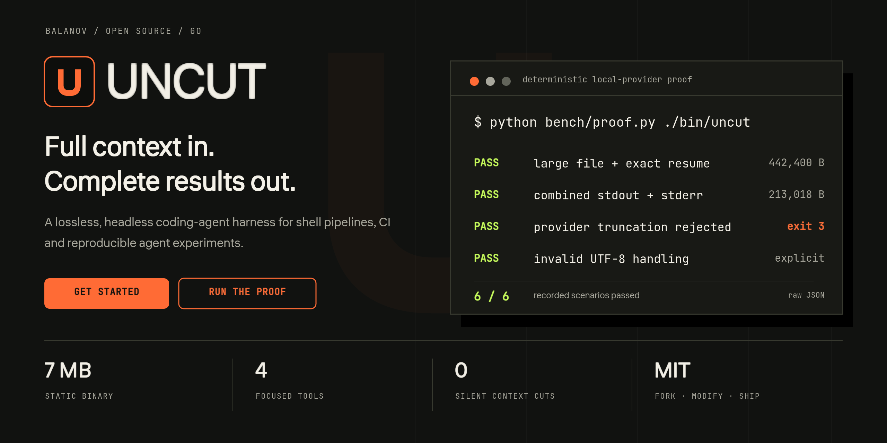
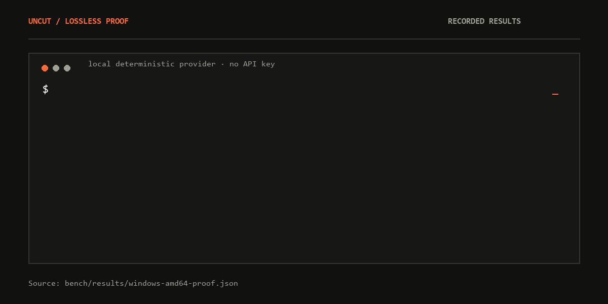
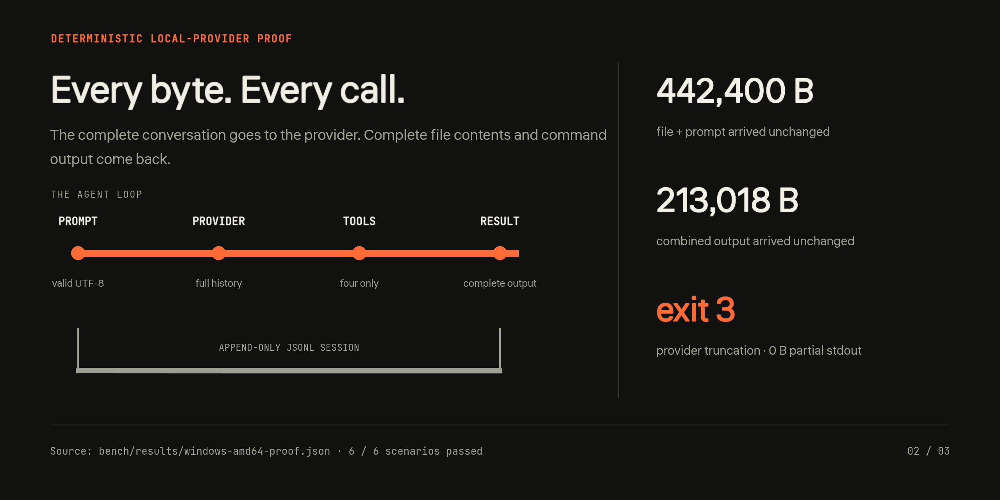

<div align="center">
  
  <p><strong>Полный контекст на входе. Полный результат на выходе. Явная ошибка вместо скрытого обрезания.</strong></p>
  <p><a href="README.md">English</a> · <a href="#быстрый-старт">Быстрый старт</a> · <a href="#проверка-lossless-контракта">Проверка</a> · <a href="BENCHMARKS.md">Измерения</a> · <a href="https://balanov.pro/uncut/">Сайт</a></p>
</div>

Краткое русское введение. Полная документация по установке для каждой ОС, флагам, конфигурации и ограничениям — в [английском README](README.md).

## Что делает UNCUT

UNCUT — небольшой coding-agent harness для shell-конвейеров, CI, контейнеров и экспериментов с агентами. Один статический Go-бинарник, четыре инструмента, обычные stdin/stdout. Нет TUI, телеметрии, плагинов, фоновых агентов, автоматических повторов и сжатия контекста.

При каждом вызове модели отправляется вся история диалога. UNCUT не обрезает содержимое файлов и объединённый вывод команд. Если провайдер оборвал ответ по лимиту, программа завершается с ошибкой, а не показывает частичный ответ как успешный.

<div align="center">
  
  <p><sub>Записанные результаты детерминированного локального провайдера. Это проверка транспорта, а не качества модели.</sub></p>
</div>

## Быстрый старт

Требуется Go 1.26+ для установки из исходников. Готовые бинарники для Linux, macOS и Windows находятся в [Releases](https://github.com/Balanov/uncut/releases/latest).

```sh
go install github.com/Balanov/uncut/cmd/uncut@latest

export UNCUT_API_KEY="ваш-ключ"
export UNCUT_MODEL="ваша-модель"
uncut "Проверь репозиторий и исправь падающие тесты"
```

Для OpenAI-совместимого провайдера задайте адрес:

```sh
export UNCUT_BASE_URL="https://openrouter.ai/api/v1"
```

Для локальной Ollama с установленной tool-capable моделью:

```sh
ollama pull qwen3:8b
export UNCUT_BASE_URL="http://localhost:11434/v1"
export UNCUT_MODEL="qwen3:8b"
uncut "Объясни архитектуру репозитория"
```

В PowerShell переменные задаются через `$env:UNCUT_BASE_URL = "..."` и `$env:UNCUT_MODEL = "..."`. Поведение tool calls зависит от выбранной модели.

## Конвейеры, события и сессии

```sh
git diff | uncut "Проверь diff. Не изменяй файлы."
cat failing-test.log | uncut "Найди вероятную причину"

uncut --json "Запусти тесты и исправь ошибку"

uncut --session .uncut/work.jsonl "Начни рефакторинг"
uncut --session .uncut/work.jsonl "Продолжи и проверь тесты"
```

`--json` выдаёт NDJSON-события `user`, `assistant`, `assistant_meta`, `tool`, затем `done` или `error`. Сессия — append-only JSONL с полной историей. Она может содержать код, вывод команд и секреты; не коммитьте её случайно.

## Четыре инструмента

| Инструмент | Поведение |
| --- | --- |
| `read_file` | Читает весь UTF-8-файл |
| `write_file` | Записывает файл целиком и создаёт родительские каталоги |
| `replace` | Заменяет ровно одно совпадение; ноль или несколько совпадений — ошибка |
| `run_command` | Возвращает код выхода и полный объединённый stdout/stderr |

Файловые пути ограничены рабочим каталогом. **UNCUT не является sandbox:** shell-команды получают права вашего пользователя ОС. Для недоверенных задач используйте одноразовый контейнер или изолированную среду.

## Проверка lossless-контракта

<div align="center">
  
</div>

```sh
go build -o bin/uncut ./cmd/uncut
python bench/proof.py ./bin/uncut
```

Проверка использует настоящий бинарник и детерминированный локальный провайдер. Нужен Python 3, но не нужны API-ключ, модель или сторонние Python-пакеты.

Записанные результаты:

- **442 400 байт** файла и prompt дошли без изменений, включая точное восстановление истории.
- **213 018 байт** объединённого stdout/stderr дошли без изменений.
- Точное редактирование завершилось реальной командой с кодом `0`.
- `finish_reason=length` дал код `3` и **0 байт частичного stdout**.
- Превышение `--max-steps=2` дало явный код `4`.
- Некорректный UTF-8 отклонён без подстановки символов замены.

Исходные данные: [`bench/results/windows-amd64-proof.json`](bench/results/windows-amd64-proof.json). Методика и ограничения: [BENCHMARKS.md](BENCHMARKS.md) и [bench/README.md](bench/README.md).

## Документация

[Полный английский README](README.md) · [Установка](README.md#install) · [Конфигурация](README.md#configuration) · [Коды выхода](README.md#exit-codes) · [Безопасность](README.md#safety) · [Разработка](README.md#develop)

[MIT](LICENSE): форкайте, изменяйте и публикуйте свои версии.
